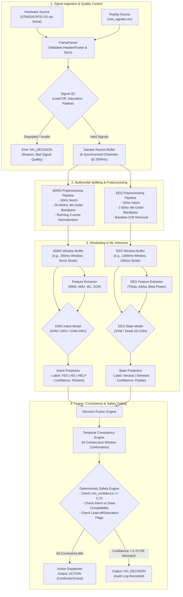

# Application Flow & Architecture
## Multimodal Assistive Silent Speech & Affective State Recognition (URF/A-SSR)

**Document Version:** 1.0  
**Date:** 2026-11-20  

---

## 1. High-Level System Architecture

The URF/A-SSR software platform is structured as an event-driven, real-time pipeline operating on synchronized multimodal bio-signals.



---

## 2. Component-by-Component Data Flow

### 2.1 Ingestion & Frame Parsing (`backend.acquisition.frame_parser`)
1. **Raw Byte Reception:** Byte chunks from serial ports or socket connections arrive in circular memory buffers.
2. **Synchronization Hunter:** The parser scans for header `0xAA 0xBB`.
3. **Payload Extraction:**
   - 4-byte `sample_id` is compared with the previous sample counter. An increment $>1$ signals lost transmission packets.
   - 8-byte `timestamp_us` is extracted.
   - 6 × 4-byte signed integers (channels 1-6) are unpacked.
   - 1-byte `event_marker` and 1-byte `status` bitfield are parsed.
4. **Validation:** Trailing footer `0xCC 0xDD` confirms frame integrity. The parsed result is returned as an immutable `Sample` object.

### 2.2 Quality Control (`backend.qc.signal_qc`)
- **Saturation Check:** Evaluates whether ADC values reach upper rail limits ($2^{23}-1$) or saturation flag bit 6 is active.
- **Lead-Off Check:** Bits 0-5 of the status bitfield represent electrode contact status. Any active lead-off triggers degraded status.
- **Flatline Check:** Evaluates variance over rolling windows; variance below $\epsilon = 10^{-6}$ indicates disconnected leads or sensor failure.

### 2.3 Preprocessing (`backend.preprocessing`)
- **sEMG Pipeline:**
  1. IIR Notch Filter: Zero-phase filtering at 50.0 Hz (or 60.0 Hz) line noise frequency.
  2. Bandpass Filter: Butterworth 4th-order filter between 20.0 Hz and 450.0 Hz to eliminate low-frequency movement artifacts and high-frequency thermal noise.
  3. Z-score scaling: Normalizes amplitude variations across recording sessions.
- **EEG Pipeline:**
  1. IIR Notch Filter: Removes power line frequency.
  2. Bandpass Filter: Butterworth 4th-order filter between 1.0 Hz and 50.0 Hz.
  3. Demeaning / Baseline Detrending: Centers prefrontal potentials.

### 2.4 Feature Extraction & Windowing (`backend.features`, `backend.windowing`)
- Sliding window buffers accumulate streaming data.
- **Window Segmentation:**
  - Standard speech intent window: 250 ms (500 samples @ 2000 Hz) with 50 ms stride (100 samples).
  - Prefrontal cognitive window: 1000 ms (2000 samples @ 2000 Hz) with 250 ms stride.
- Features are computed deterministically per window without cross-window state leakage.

### 2.5 Inference Execution (`backend.models`)
- **EMG Intent Branch:**
  - Evaluates window representations through selected model (`SVM`, `GRU`, or `CNN-GRU`).
  - Produces a softmax probability distribution over `{"YES", "NO", "HELP"}`.
  - Returns `Prediction(label=..., confidence=max(p), probabilities=p)`.
- **EEG Affective Branch:**
  - Evaluates window representations through selected model (`SVM` or `1D-CNN`).
  - Produces a probability distribution over `{"Neutral", "Stressed"}`.
  - Returns `Prediction(label=..., confidence=max(p), probabilities=p)`.

### 2.6 Decision Fusion & Temporal Consistency (`backend.fusion`)
- **Multimodal Alignment:** Synchronizes the most recent speech intent prediction with the current cognitive/affective state prediction.
- **Temporal Consistency Filter:**
  - A circular buffer of length $K$ (nominal $K=3$) holds recent predictions.
  - A candidate intent is only forwarded if at least $M$ of $K$ consecutive windows output the identical intent.

### 2.7 Deterministic Safety Engine (`backend.safety.safety_engine`)
- **Evaluation Logic:**
  ```python
  if intent == "HELP":
      if state != trigger_state:  # Must be "Stressed"
          return NO_DECISION("state_mismatch")
      if intent_confidence < 0.70:
          return NO_DECISION("intent_confidence_below_threshold")
      if state_confidence < 0.70:
          return NO_DECISION("state_confidence_below_threshold")
      if not temporal_consistency_met:
          return NO_DECISION("temporal_consistency_not_met")
      if signal_quality != "OK":
          return NO_DECISION("signal_quality_not_ok")
      return ACTION("all_rules_passed")
  elif intent in ("YES", "NO"):
      if intent_confidence < 0.70:
          return NO_DECISION("intent_confidence_below_threshold")
      return ACTION(f"confirmed_{intent.lower()}")
  ```
- **Audit Logging:** Logs the complete state vector to disk for retrospective clinical validation.
