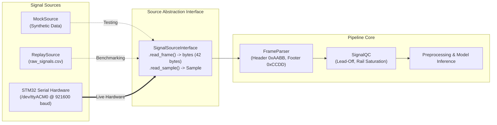

# Hardware Integration Guide: Migrating from Mock to STM32 Hardware
## Multimodal Assistive Silent Speech & Affective State Recognition (URF/A-SSR)

**Document Version:** 1.0  
**Date:** 2026-11-20  

---

## 1. Overview & Integration Architecture

The URF/A-SSR software platform is designed with a strict hardware abstraction layer (HAL) allowing seamless transitions between:
1. **Mock Signal Generators:** Deterministic synthetic sine/square wave generators for software unit testing (`backend.realtime.mock_source`).
2. **Recorded CSV Replay:** Clock-synchronized playback of pre-recorded patient or public datasets (`backend.realtime.replay`).
3. **Physical Hardware Stream:** High-speed serial connection from an **STM32F4 / STM32H7 / ESP32-S3** microcontroller acquiring data from a Texas Instruments **ADS1298** analog front-end (AFE).



---

## 2. STM32 Firmware Implementation Guide

### 2.1 Hardware Configuration
- **MCU:** STM32F401 / STM32F411 / STM32H743 running at 84–480 MHz.
- **AFE:** TI ADS1298 (8-channel 24-bit simultaneous sampling bio-potential ADC).
- **Interface to AFE:** SPI master mode with DMA in circular mode, triggered by the `DRDY` (Data Ready) pin interrupt.
- **Interface to Host PC:** USB Virtual COM Port (CDC Class) or USART with FTDI USB-to-UART bridge running at 921,600 baud.

### 2.2 C Firmware Packet Assembly Snippet
```c
/* stm32_packet_generator.c */
#include <stdint.h>
#include <string.h>

#define FRAME_HEADER 0xBBAA  // Little-endian wire format for 0xAA 0xBB
#define FRAME_FOOTER 0xDDCC  // Little-endian wire format for 0xCC 0xDD

#pragma pack(push, 1)
typedef struct {
    uint16_t header;        // 0xAA, 0xBB
    uint32_t sample_id;     // Monotonic counter
    uint64_t timestamp_us;  // Microsecond timer (TIM2/TIM5 32-bit prescaled)
    int32_t  channels[6];   // CH1 (EEG_Fp1), CH2 (EEG_Fp2), CH3-CH6 (EMG 1-4)
    uint8_t  event_marker;  // Current stimulus / trigger code
    uint8_t  status;        // Lead-off and saturation bitfield
    uint16_t footer;        // 0xCC, 0xDD
} BioPacket_t;
#pragma pack(pop)

void Send_Bio_Sample(uint32_t sample_id, uint64_t timestamp_us, int32_t adc_data[6], uint8_t event_code, uint8_t status_bits) {
    BioPacket_t packet;
    packet.header = 0xBBAA;
    packet.sample_id = sample_id;
    packet.timestamp_us = timestamp_us;
    
    // Copy 6 channels (2 EEG, 4 sEMG)
    for (int i = 0; i < 6; i++) {
        packet.channels[i] = adc_data[i];
    }
    
    packet.event_marker = event_code;
    packet.status = status_bits;
    packet.footer = 0xDDCC;
    
    // Transmit over USB CDC or UART DMA
    CDC_Transmit_FS((uint8_t*)&packet, sizeof(BioPacket_t));
}
```

---

## 3. Host-Side Python Integration

### 3.1 Implementing `SerialHardwareSource`
Create `backend/acquisition/serial_source.py`:

```python
"""backend/acquisition/serial_source.py"""
from __future__ import annotations
import serial
import time
from typing import Optional
from backend.acquisition.frame_parser import FrameParser, Sample, FRAME_SIZE

class SerialHardwareSource:
    """
    Acquires real-time 42-byte binary frames from physical STM32 serial port.
    """
    def __init__(self, port: str = "/dev/ttyACM0", baudrate: int = 921600, timeout: float = 0.1):
        self.port = port
        self.baudrate = baudrate
        self.timeout = timeout
        self.ser: Optional[serial.Serial] = None
        self.parser = FrameParser()

    def open(self) -> None:
        self.ser = serial.Serial(self.port, self.baudrate, timeout=self.timeout)
        self.ser.reset_input_buffer()

    def close(self) -> None:
        if self.ser and self.ser.is_open:
            self.ser.close()

    def read_sample(self) -> Sample:
        if not self.ser or not self.ser.is_open:
            raise RuntimeError("Serial port not open.")
        
        # Read exact 42-byte frame
        raw_bytes = self.ser.read(FRAME_SIZE)
        if len(raw_bytes) != FRAME_SIZE:
            raise TimeoutError(f"Expected {FRAME_SIZE} bytes, received {len(raw_bytes)}")
            
        return self.parser.parse_frame(raw_bytes)
```

### 3.2 Swapping Configuration in `configs/final_pipeline.yaml`

Modify `configs/final_pipeline.yaml` to switch from mock or replay mode to live serial:

```yaml
# Pipeline Acquisition Mode
acquisition:
  source_type: "serial"          # Options: "mock", "replay", "serial"
  serial_port: "/dev/ttyACM0"    # STM32 USB Virtual COM Port
  baudrate: 921600               # 42 bytes * 2000 SPS = 84,000 B/s (672 kbaud min)
  buffer_size: 8192

hardware:
  mcu: "STM32F401RE"
  afe: "ADS1298"
  sampling_rate_hz: 2000
  adc_resolution_bits: 24
```

---

## 4. Hardware Verification & Calibration Procedure

Before operating the full ML inference and safety engine on physical hardware, run the hardware diagnostic verification script:

```bash
python3 scripts/validate_hardware.py --port /dev/ttyACM0
```

### Automated Acceptance Checks Executed:
1. **H-1: Channel Mapping Verification:** Verifies 6 channels are received and mapped in canonical order (CH1: Fp1, CH2: Fp2, CH3: Submental, CH4: Orbicularis, CH5: Zygomaticus, CH6: Buccinator).
2. **H-2: Sampling Rate Verification:** Verifies measured sample rate from `sample_id` delta matches target $2000 \pm 10\text{ SPS}$.
3. **H-3: Microsecond Synchronization Check:** Asserts `timestamp_us` increases monotonically without jitter exceeding $100\,\mu\text{s}$.
4. **H-4: Frame Drop Detection:** Ensures dropped frame rate is $< 0.01\%$.
5. **H-5: Lead-Off & Saturation Integrity:** Validates that disconnecting an electrode immediately trips the status bitfield and triggers the `NO_DECISION` safety fallback.
